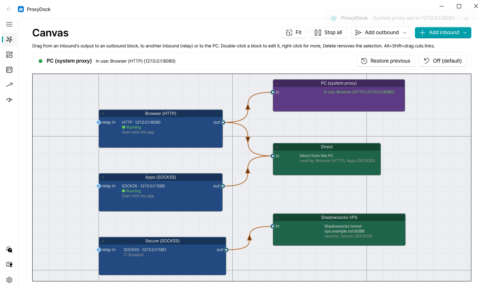

# ProxyDock

**English** · [한국어](docs/README.ko.md) · [日本語](docs/README.ja.md) · [简体中文](docs/README.zh-CN.md) · [繁體中文](docs/README.zh-TW.md) · [Deutsch](docs/README.de.md) · [Français](docs/README.fr.md) · [Español](docs/README.es.md)

A desktop "dock" for proxies: create several proxies and turn each one on or off. Made for personal use.

Each proxy combines an **inbound** (how it accepts connections on a port of this PC) and an **outbound**
(how it reaches the destination). For example, "accept on a local SOCKS5 port → encrypted tunnel to a remote
Shadowsocks server" is a single card.

<p align="center">
  
</p>
<p align="center">
  
  
</p>

## Features

| | Supported |
|---|---|
| Inbound | SOCKS5 · SOCKS4/4a · HTTP · HTTPS (TLS) · Shadowsocks server · Hysteria2 server |
| Outbound | Direct · upstream HTTP / HTTPS / SOCKS4 / SOCKS5 proxy · Shadowsocks tunnel · Hysteria2 (QUIC) tunnel |
| UDP | inbound SOCKS5 · Shadowsocks · Hysteria2, outbound Direct · Shadowsocks · Hysteria2 |

- **Canvas**: blueprint-style editor - drag lines from inbound blocks to outbound blocks; several inbounds can share one outbound, an inbound linked into another inbound relays through it, and Direct can leave from a chosen source IP
- **PC block**: link an HTTP inbound to use it as the Windows system proxy while it runs; the previous settings are saved and put back when it stops or the app quits (Restore previous / Off buttons)
- **Chaining**: an outbound block's 'via' output sends its own server connection through another outbound (e.g. Shadowsocks through the company HTTP proxy, HTTPS upstream through a Hysteria2 tunnel), as many hops as needed
- **Router**: put a router block between an inbound and its outbounds - rules on domains, IP ranges, ports, programs
  (chrome.exe, ...), GeoIP countries and Geosite categories each get their own output; unmatched traffic takes the
  default. Rules can lead to any outbound, to the **Block** outbound (refuse) or to another router
- **Network interface**: any outbound can leave through a chosen network card - Tailscale, WireGuard, a VPN app, Wi-Fi - without changing the PC's routes, so only the traffic you link there uses it (sing-box engine)
- **Engine**: sing-box (default) runs each proxy in its own process - multi-core, UDP through chains, Hysteria2 through other outbounds. The built-in Python engine is the fallback (Settings → Proxy engine)
- **Shadowsocks**: AEAD 2018 (aes-128/256-gcm, chacha20-ietf-poly1305) and 2022 (SIP022, blake3), TCP+UDP, copy `ss://` links
- **Hysteria2**: interoperates both ways with the official implementation (TCP and UDP), certificate pinning, copy `hysteria2://` links
- **Settings**: global defaults + per-proxy local settings (local wins) - allowed domains, private network blocking, idle timeout, logging
- **Check connection** in the editor: tests the outbound (upstream/tunnel, passwords) and the inbound port before saving
- **Connection test**: connects to 21 sites in many countries over HTTPS through a running proxy and measures response times
- **Logs / statistics** per proxy, live throughput graph, optional log file
- **Security**: passwords stored with Windows DPAPI (0600 files on other OSes), per-IP connection limits,
  temporary bans after repeated authentication failures, proxy chain loop detection, Windows Firewall block button
- **Languages**: English (default), 한국어, 日本語, 简体中文, 繁體中文, Deutsch, Français, Español (Settings → Display → Language)
- Tray, start at login, light/dark theme, built-in fonts (Pretendard / Pretendard JP / Noto Sans SC·TC / JetBrains Mono)

## Running

Use a build from [Releases](https://github.com/NenkaLab/proxy-dock/releases) if there is one, or run from source:

```bash
python -m venv .venv
# Windows: .venv\Scripts\activate   /   macOS, Linux: source .venv/bin/activate
pip install -r requirements.txt
python tools/fetch_singbox.py   # sing-box engine (without it proxies use the Python engine)
python proxydock.py            # --hidden : start in the tray without a window
```

Developed and tested with Python 3.14.

There are no proxies on first launch. Pick a template under **New proxy** (Local SOCKS5, Local HTTP,
Shadowsocks server, Local → Shadowsocks tunnel, ...) and start it with the switch on its card.
The **How to use** page in the app has the details.

Settings location

| OS | Path |
|---|---|
| Windows | `%APPDATA%\ProxyDock` |
| macOS | `~/Library/Application Support/ProxyDock` |
| Linux | `$XDG_CONFIG_HOME/ProxyDock` (default `~/.config/ProxyDock`) |

## Building

Everything for building lives in [`tools/`](tools/). PyInstaller produces a single executable (an `.app` on macOS).
The scripts create a virtual environment per OS, install only the packages that differ from `requirements.txt`,
and build with `tools/ProxyDock.spec`. They can be run from any folder.

| Command | Output |
|---|---|
| `tools\build_win.bat` | `dist/win/ProxyDock.exe` (on Windows) |
| `tools\build_linux.bat` / `tools/build_linux.sh` | `dist/linux/ProxyDock` (natively on Linux, with Docker on Windows/macOS) |
| `tools/build_mac.sh` | `dist/mac/ProxyDock.app` (on macOS only) |
| `tools\build.bat` / `tools/build.sh` | everything this computer can build, with a summary |

The macOS build has not been tried on a real Mac yet.

## Releases and CI

- Every push and pull request runs the tests on Windows, Linux and macOS ([CI](.github/workflows/ci.yml),
  `python tests/run_tests.py` locally - no internet needed).
- `tools\release.bat 2.1.0` (or `python tools/release.py 2.1.0`) checks the working tree, runs the tests, bumps
  `__version__`, commits, tags `v2.1.0` and pushes. The tag starts the [release workflow](.github/workflows/release.yml),
  which builds Windows / Linux / macOS and publishes a GitHub Release with the archives and `SHA256SUMS.txt`.
  Add `--dry-run` to rehearse.
- `python tools/build.py package win|linux|mac` makes the same archives locally in `dist/release/`.

## Known limitations

- Router and Block blocks need the sing-box engine. IP and GeoIP rules resolve the domain on this PC first, so a tunnel
  behind them connects to the IP instead of resolving the domain remotely. Program rules only see connections from this PC.
- sing-box engine: a Hysteria2 server open to other PCs runs on the official Hysteria2 core, which asks ProxyDock about every
  login (sing-box cannot report wrong passwords, so IP bans would not work); its traffic then goes through sing-box. Certificate
  pinning still runs on the Python engine (needs sing-box 1.15). The per-IP connection limit closes extra connections after
  the fact; the idle timeout applies to UDP only; 'Log connection close details' is not available.
- Python engine: Hysteria2 cannot go *through* other outbounds, UDP is not relayed through chained outbounds, and Hysteria2
  (aioquic) reaches about 100 Mbps. Neither engine supports Hysteria2 bandwidth settings (Brutal), Salamander or port hopping.
- The official Hysteria2 server rejects connections whose SNI does not match its certificate - put the server
  certificate's domain into the outbound SNI field.
- The HTTP inbound handles one plain (non-CONNECT) request per connection.
- SOCKS4 has no password authentication, so only use it on this PC.

## Layout

```
proxydock.py            entry point
proxydock/
  common.py             shared constants, logging, address handling, bans
  config.py             settings format (v2), validation, global/local merge, password storage, migration
  graph.py              block graph (inbound / outbound / PC blocks) -> runtime proxies
  runtime.py            ProxyInstance / ProxyManager (many proxies on one asyncio thread)
  relay.py              TCP/UDP relay core
  inbound.py            inbound protocols
  outbound.py           outbound protocols
  ss.py                 Shadowsocks 2018/2022 encryption
  hysteria2.py          Hysteria2 server and client (aioquic)
  singbox/              sing-box engine: config compiler, process runner, ban / per-IP limit guard
  tls.py                self-signed certificates, TLS contexts
  probe.py              connection test / connection check
  platform_utils.py     start at login, firewall, port check
  i18n.py, locales/     translations (English source strings -> <language>.json)
  ui/                   PySide6 + Fluent Widgets UI
    canvas.py           canvas page (NodeGraphQt)
tools/                  build scripts, PyInstaller spec, Linux build Dockerfile
licenses/               licenses of the bundled third-party components
docs/                   translated READMEs, screenshots
```

### Translations

UI strings are written in English in the code (`_t("...")`) and translated through
`proxydock/locales/<language>.json`. A missing entry falls back to English.

## License

[GPL-3.0](LICENSE). The UI library [PySide6-Fluent-Widgets](https://github.com/zhiyiYo/PyQt-Fluent-Widgets) is
GPL v3, so this program is distributed under GPL v3 as well; distributing built executables must follow the GPL v3
terms (providing the source, etc.).

Licenses of the bundled fonts and libraries are in [`licenses/`](licenses/).

| Component | License |
|---|---|
| Pretendard, Pretendard JP, Noto Sans SC/TC, JetBrains Mono (bundled fonts) | SIL OFL 1.1 |
| PySide6-Fluent-Widgets | GPL v3 |
| sing-box | GPL v3 |
| Hysteria2 | MIT |
| Qt 6 / PySide6 / Shiboken6, PySideSix-Frameless-Window | LGPL v3 |
| aioquic, pylsqpack, darkdetect | BSD 3-Clause |
| cryptography | Apache 2.0 / BSD 3-Clause |
| pyOpenSSL | Apache 2.0 |
| service-identity, attrs, NodeGraphQt, Qt.py | MIT |
| certifi | MPL 2.0 |
| Python runtime | PSF License |
| PyInstaller bootloader | GPL v2+ (bootloader exception) |

Copyright (C) 2026 NenkaLab
