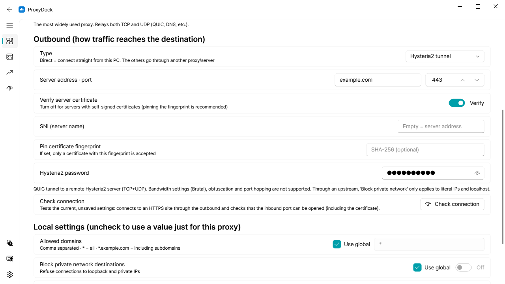

# ProxyDock

[English](../README.md) · [한국어](README.ko.md) · [日本語](README.ja.md) · [简体中文](README.zh-CN.md) · [繁體中文](README.zh-TW.md) · **Deutsch** · [Français](README.fr.md) · [Español](README.es.md)

Ein Desktop-„Dock" für Proxys: mehrere Proxys anlegen und jeden einzeln ein- oder ausschalten. Für den persönlichen Gebrauch entstanden.

Jeder Proxy kombiniert einen **Eingang** (wie er Verbindungen an einem Port dieses PCs annimmt) und einen **Ausgang**
(wie er das Ziel erreicht). So ist z. B. „Annahme über lokales SOCKS5 → verschlüsselter Tunnel zu einem entfernten
Shadowsocks-Server" eine einzige Karte.

<p align="center">
  
  
</p>

## Funktionen

| | Unterstützt |
|---|---|
| Eingang | SOCKS5 · SOCKS4/4a · HTTP · HTTPS (TLS) · Shadowsocks-Server · Hysteria2-Server |
| Ausgang | Direct · Upstream-HTTP / HTTPS / SOCKS4 / SOCKS5-Proxy · Shadowsocks-Tunnel · Hysteria2-Tunnel (QUIC) |
| UDP | Eingang SOCKS5 · Shadowsocks · Hysteria2, Ausgang Direct · Shadowsocks · Hysteria2 |

- **Shadowsocks**: AEAD 2018 (aes-128/256-gcm, chacha20-ietf-poly1305) und 2022 (SIP022, blake3), TCP+UDP, `ss://`-Links kopieren
- **Hysteria2**: in beide Richtungen mit der offiziellen Implementierung kompatibel (TCP und UDP), Zertifikats-Pinning, `hysteria2://`-Links kopieren
- **Einstellungen**: globale Standardwerte + lokale Einstellungen pro Proxy (lokal hat Vorrang) - zugelassene Domains, Blockieren privater Netze, Leerlauf-Timeout, Protokoll
- **Verbindung prüfen** im Editor: testet vor dem Speichern den Ausgang (Upstream/Tunnel, Passwörter) und den Eingangsport
- **Verbindungstest**: verbindet sich über einen laufenden Proxy per HTTPS mit 21 Websites in vielen Ländern und misst die Antwortzeiten
- **Protokoll / Statistik** pro Proxy, Live-Durchsatzgraph, optionale Protokolldatei
- **Sicherheit**: Passwörter per Windows DPAPI gespeichert (auf anderen Systemen 0600-Dateien), Verbindungslimit pro IP,
  vorübergehende Sperre nach wiederholten Anmeldefehlern, Erkennung von Schleifen in Proxy-Ketten, Windows-Firewall-Sperre per Knopfdruck
- **Sprachen**: English (Standard), 한국어, 日本語, 简体中文, 繁體中文, Deutsch, Français, Español (Einstellungen → Anzeige → Sprache)
- Infobereich, Start bei Anmeldung, helles/dunkles Design, integrierte Schriften (Pretendard / JetBrains Mono)

## Ausführen

Nutzen Sie einen Build aus den [Releases](https://github.com/NenkaLab/proxy-dock/releases), falls vorhanden, oder starten Sie aus dem Quellcode:

```bash
python -m venv .venv
# Windows: .venv\Scripts\activate   /   macOS, Linux: source .venv/bin/activate
pip install -r requirements.txt
python proxydock.py            # --hidden : ohne Fenster im Infobereich starten
```

Entwickelt und getestet mit Python 3.14.

Beim ersten Start gibt es keine Proxys. Wählen Sie unter **Neuer Proxy** eine Vorlage (Lokaler SOCKS5, Lokaler HTTP,
Shadowsocks-Server, Lokal → Shadowsocks-Tunnel, ...) und starten Sie sie mit dem Schalter auf der Karte.
Details stehen auf der Seite **Anleitung** in der App. Die Oberfläche ist standardmäßig englisch; die Sprache lässt sich
unter Einstellungen → Anzeige → Sprache ändern (nach Neustart wirksam).

Speicherort der Einstellungen

| System | Pfad |
|---|---|
| Windows | `%APPDATA%\ProxyDock` |
| macOS | `~/Library/Application Support/ProxyDock` |
| Linux | `$XDG_CONFIG_HOME/ProxyDock` (Standard `~/.config/ProxyDock`) |

## Bauen

Alles zum Bauen liegt in [`tools/`](../tools/). PyInstaller erzeugt eine einzelne ausführbare Datei (unter macOS eine `.app`).
Die Skripte legen pro System eine virtuelle Umgebung an, installieren nur die Pakete, die von `requirements.txt` abweichen,
und bauen mit `tools/ProxyDock.spec`. Sie lassen sich aus jedem Ordner starten.

| Befehl | Ergebnis |
|---|---|
| `tools\build_win.bat` | `dist/win/ProxyDock.exe` (unter Windows) |
| `tools\build_linux.bat` / `tools/build_linux.sh` | `dist/linux/ProxyDock` (nativ unter Linux, per Docker unter Windows/macOS) |
| `tools/build_mac.sh` | `dist/mac/ProxyDock.app` (nur unter macOS) |
| `tools\build.bat` / `tools/build.sh` | alles, was dieser Computer bauen kann, mit Zusammenfassung |

Der macOS-Build wurde noch nicht auf einem echten Mac getestet.

## Bekannte Einschränkungen

- Hysteria2 läuft auf einer QUIC-Implementierung in Python (aioquic) und schafft etwa 100 Mbit/s. Bandbreiteneinstellungen (Brutal),
  Salamander-Verschleierung und Port-Hopping werden nicht unterstützt.
- Der offizielle Hysteria2-Server lehnt Verbindungen ab, deren SNI nicht zum Zertifikat passt - tragen Sie die Domain des
  Serverzertifikats im SNI-Feld des Ausgangs ein.
- Der HTTP-Eingang bearbeitet pro Verbindung nur eine normale (Nicht-CONNECT-)Anfrage.
- SOCKS4 hat keine Passwort-Anmeldung, nutzen Sie es daher nur auf diesem PC.
- Japanisch und Chinesisch verwenden die UI-Schrift des Systems (das integrierte Pretendard deckt Koreanisch und Latein ab).

## Aufbau

```
proxydock.py            Einstiegspunkt
proxydock/
  common.py             gemeinsame Konstanten, Protokoll, Adressbehandlung, Sperren
  config.py             Einstellungsformat (v2), Prüfung, Zusammenführung global/lokal, Passwortspeicher, Migration
  runtime.py            ProxyInstance / ProxyManager (viele Proxys in einem asyncio-Thread)
  relay.py              TCP/UDP-Relay-Kern
  inbound.py            Eingangsprotokolle
  outbound.py           Ausgangsprotokolle
  ss.py                 Shadowsocks-2018/2022-Verschlüsselung
  hysteria2.py          Hysteria2-Server und -Client (aioquic)
  tls.py                selbstsignierte Zertifikate, TLS-Kontexte
  probe.py              Verbindungstest / Verbindungsprüfung
  platform_utils.py     Start bei Anmeldung, Firewall, Portprüfung
  i18n.py, locales/     Übersetzungen (englische Ausgangstexte -> <Sprache>.json)
  ui/                   Oberfläche mit PySide6 + Fluent Widgets
tools/                  Build-Skripte, PyInstaller-Spec, Dockerfile für den Linux-Build
licenses/               Lizenzen der enthaltenen Drittkomponenten
docs/                   übersetzte READMEs, Screenshots
```

### Übersetzungen

Die Texte der Oberfläche stehen englisch im Code (`_t("...")`) und werden über `proxydock/locales/<Sprache>.json` übersetzt.
Fehlende Einträge erscheinen auf Englisch.

## Lizenz

[GPL-3.0](../LICENSE). Die UI-Bibliothek [PySide6-Fluent-Widgets](https://github.com/zhiyiYo/PyQt-Fluent-Widgets) steht unter
GPL v3, daher wird auch dieses Programm unter GPL v3 verteilt; wer gebaute Programmdateien weitergibt, muss die Bedingungen der
GPL v3 einhalten (Quellcode bereitstellen usw.).

Die Lizenzen der enthaltenen Schriften und Bibliotheken liegen im Ordner [`licenses/`](../licenses/).

| Komponente | Lizenz |
|---|---|
| Pretendard, JetBrains Mono (integrierte Schriften) | SIL OFL 1.1 |
| PySide6-Fluent-Widgets | GPL v3 |
| Qt 6 / PySide6 / Shiboken6, PySideSix-Frameless-Window | LGPL v3 |
| aioquic, pylsqpack, darkdetect | BSD 3-Clause |
| cryptography | Apache 2.0 / BSD 3-Clause |
| pyOpenSSL | Apache 2.0 |
| service-identity, attrs | MIT |
| certifi | MPL 2.0 |
| Python-Laufzeit | PSF License |
| PyInstaller-Bootloader | GPL v2+ (Bootloader-Ausnahme) |

Copyright (C) 2026 NenkaLab
