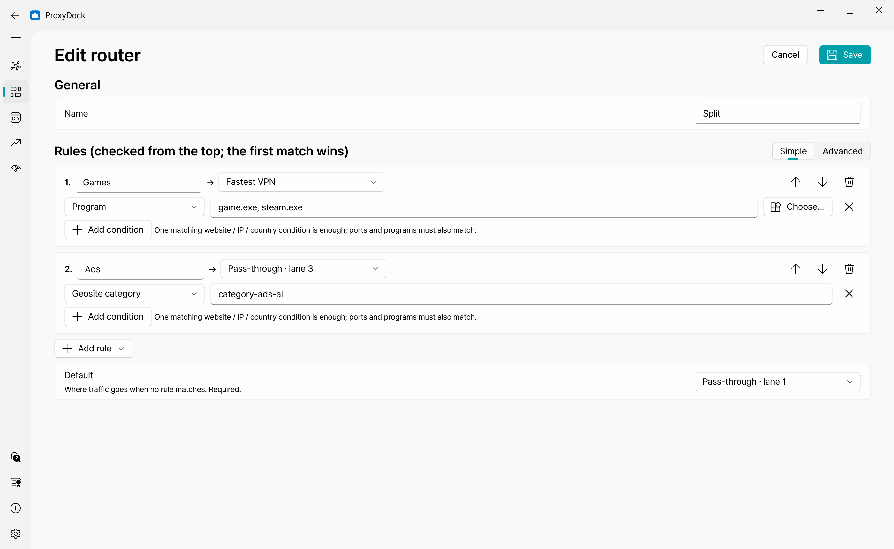

# ProxyDock

[English](../README.md) · [한국어](README.ko.md) · [日本語](README.ja.md) · [简体中文](README.zh-CN.md) · [繁體中文](README.zh-TW.md) · [Deutsch](README.de.md) · [Français](README.fr.md) · **Español**

Una aplicación de escritorio que ejecuta varios proxies y túneles a la vez. En un lienzo se conectan bloques de
**entrada** (cómo entra el tráfico, p. ej. un puerto SOCKS5 local) con bloques de **salida** (cómo sale,
p. ej. un servidor Shadowsocks), y cada tarjeta se enciende o se apaga.

Hecho para uso personal y compartido tal cual.

  <picture>
    <source media="(prefers-color-scheme: dark)" srcset="images/canvas-dark.png">
    
  </picture>

  <picture>
    <source media="(prefers-color-scheme: dark)" srcset="images/proxies-dark.png">
    
  </picture>
  <picture>
    <source media="(prefers-color-scheme: dark)" srcset="images/router-dark.png">
    
  </picture>

## Funciones

- **Unir bloques en un lienzo**: entradas (SOCKS5, HTTP, servidor Shadowsocks / Hysteria2 / WireGuard, TUN, ...)
  con salidas (Directo, proxy superior, Shadowsocks, Hysteria2, WireGuard, VLESS, VMess, Trojan, TUIC, suscripciones)
- **Enrutamiento**: repartir el tráfico por dominio, IP, programa o país; un interruptor IF sirve de kill switch; los
  grupos usan el servidor más rápido o cambian si uno falla
- **Cadenas**: enviar una salida a través de otra, o a través de Tailscale, una app de VPN o el Wi-Fi
- **Proxy del sistema**: usar una tarjeta como proxy del sistema de Windows mientras funciona
- **Herramientas de uso diario**: enlaces para compartir, pruebas de conexión, registros y estadísticas en vivo,
  8 idiomas, bandeja

Los proxies funcionan con [sing-box](https://github.com/SagerNet/sing-box), incluido en la versión publicada.

## Ejecutar

En Windows, `ProxyDock-<versión>-windows-x64-setup.exe` la instala para tu usuario (sin permisos de administrador); el `.zip` es la misma aplicación como carpeta. En macOS, abre el `.dmg` y arrastra ProxyDock a Aplicaciones. En Linux, da permiso de ejecución al `.AppImage` y ejecútalo.

Descarga una versión de [Releases](https://github.com/NenkaLab/proxy-dock/releases).

Los ajustes se guardan en `%APPDATA%\ProxyDock` (macOS: `~/Library/Application Support/ProxyDock`,
Linux: `~/.config/ProxyDock`). La página **Cómo usar** de la aplicación explica el resto.

## Compilar

Ejecutar desde el código fuente, pruebas, compilación, instaladores y versiones: [Build.md](Build.md) (en inglés).

## Limitaciones

- Los routers, grupos, WireGuard, VLESS / VMess / Trojan / TUIC y TUN necesitan el motor sing-box (incluido).
- TUN y macOS todavía no se han probado en equipos reales.
- SOCKS4 no tiene contraseña: úsalo solo en este PC.

## Licencia

[GPL-3.0](../LICENSE). Los componentes incluidos (sing-box GPL-3.0, Hysteria MIT, Qt / PySide6 LGPL-3.0, fuentes OFL-1.1, ...)
y sus licencias están en [`licenses/`](../licenses/).

Copyright (C) 2026 NenkaLab
