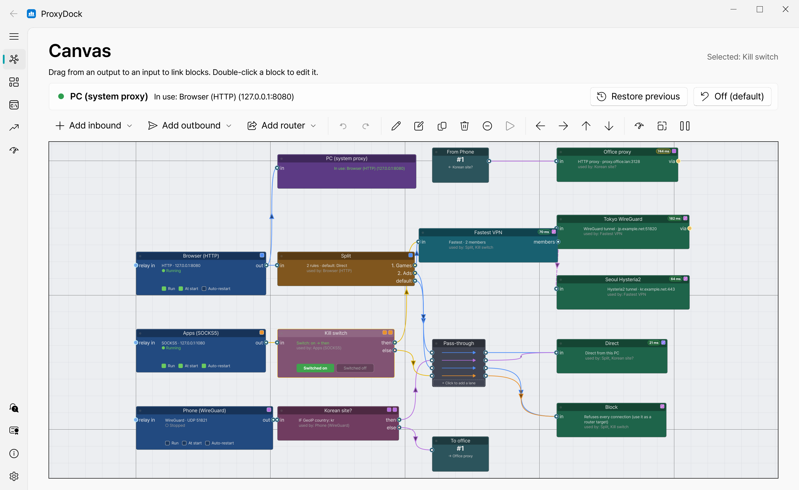

# ProxyDock

[English](../README.md) · [한국어](README.ko.md) · **日本語** · [简体中文](README.zh-CN.md) · [繁體中文](README.zh-TW.md) · [Deutsch](README.de.md) · [Français](README.fr.md) · [Español](README.es.md)

複数のプロキシやトンネルを並べて動かすデスクトップアプリです。キャンバスで**受信側**ブロック (通信の入口、例: ローカル SOCKS5 ポート) を
**送信側**ブロック (出口、例: Shadowsocks サーバー) につなぎ、カードごとにオン・オフします。

<p align="center">
  <picture>
    <source media="(prefers-color-scheme: dark)" srcset="images/canvas-dark.png">
    
  </picture>
</p>
<p align="center">
  <picture>
    <source media="(prefers-color-scheme: dark)" srcset="images/proxies-dark.png">
    
  </picture>
  <picture>
    <source media="(prefers-color-scheme: dark)" srcset="images/router-dark.png">
    
  </picture>
</p>

## 機能

- **受信側**: SOCKS5、SOCKS4、HTTP、HTTPS、Shadowsocks サーバー、Hysteria2 サーバー、WireGuard サーバー (スマホや PC が WireGuard アプリで接続)、ポート転送、TUN (この PC のすべてのアプリ)
- **送信側**: Direct、HTTP / HTTPS / SOCKS プロキシ、Shadowsocks、Hysteria2、WireGuard、VLESS (REALITY)、VMess、
  Trojan、TUIC、サブスクリプション (共有リンクまたは Clash YAML)
- **ブロック**: チェーン (送信側を別の送信側経由に)、ルーター (ドメイン・IP・ポート・プログラム (実行中の一覧から選択)・GeoIP/Geosite のルール、かんたん・詳細表示)、
  IF (条件 1 つ、またはキルスイッチなどの手動オン/オフ スイッチ)、グループ (最速、自動切り替え、手動)、ブロック
- **ネットワークインターフェース**: PC のルーティングを変えずに、送信側を Tailscale、VPN アプリ、Wi-Fi から出す
- **DNS**: PC の DNS、DoH / DoT / DoQ、カードごとの設定、トンネル経由、TUN 用の Fake-IP
- **カード**: ブロック上で実行、起動時に実行、自動再起動 (止まったり起動に失敗したりしたとき)
- **PC ブロック**: HTTP 受信側を動作中だけ Windows のシステムプロキシとして使う
- 共有リンク (`ss://`、`vless://`、`vmess://`、`trojan://`、`tuic://`、`hysteria2://`)、接続確認・テスト、ログとリアルタイム統計、
  8 言語、トレイ、ログイン時に起動

プロキシは [sing-box](https://github.com/SagerNet/sing-box) で動きます (カードごとに 1 プロセス、リリースに同梱)。
他の PC に公開する Hysteria2 サーバーは公式の [Hysteria](https://github.com/apernet/hysteria) コアで動き、内蔵の Python エンジンは予備です。

## 実行

Windows では `ProxyDock-<バージョン>-windows-x64-setup.exe` が現在のユーザーにインストールします (管理者権限は不要)。`.zip` は同じアプリをフォルダーにしたものです。

[Releases](https://github.com/NenkaLab/proxy-dock/releases) からビルドを入手するか、ソースから実行します (Python 3.14):

```bash
python -m venv .venv
.venv\Scripts\activate            # macOS / Linux: source .venv/bin/activate
pip install -r requirements.txt
python tools/fetch_singbox.py     # この PC 用の sing-box と Hysteria
python proxydock.py
```

設定は `%APPDATA%\ProxyDock` (macOS: `~/Library/Application Support/ProxyDock`、Linux: `~/.config/ProxyDock`) に
保存されます。詳しくはアプリの**使い方**ページを見てください。

## ビルド

`tools\build_win.bat` → `dist/win/ProxyDock/ProxyDock.exe` (Linux: `tools/build_linux.sh`、macOS: `tools/build_mac.sh`)。
ビルド時に sing-box と Hysteria をダウンロードし (SHA-256 確認)、アプリに同梱します。
テスト: `python tests/run_tests.py`。リリース: `tools\release.bat <バージョン>` がタグを付けて push し、GitHub Actions がビルドします。
インストーラー: `python tools/build.py installer` (Inno Setup 6)。

## 制限

- ルーター、グループ、WireGuard、VLESS / VMess / Trojan / TUIC、TUN、インターフェース選択、DNS サーバー指定には sing-box エンジンが必要です。
- 複数サーバーへの負荷分散はなく、Hysteria2 サーバーは単独ではポート範囲で待ち受けられません。
- 証明書のピン留めは sing-box 1.15 までは Python エンジンで動きます。
- TUN と Fake-IP はまだ実際の環境で試しておらず、macOS も実機の Mac で試していません。
- SOCKS4 にはパスワードがないので、この PC 内だけで使ってください。

## ライセンス

[GPL-3.0](../LICENSE)。同梱のコンポーネント (sing-box GPL-3.0、Hysteria MIT、Qt / PySide6 LGPL-3.0、フォント OFL-1.1 など) と
ライセンスは [`licenses/`](../licenses/) にあります。

Copyright (C) 2026 NenkaLab
