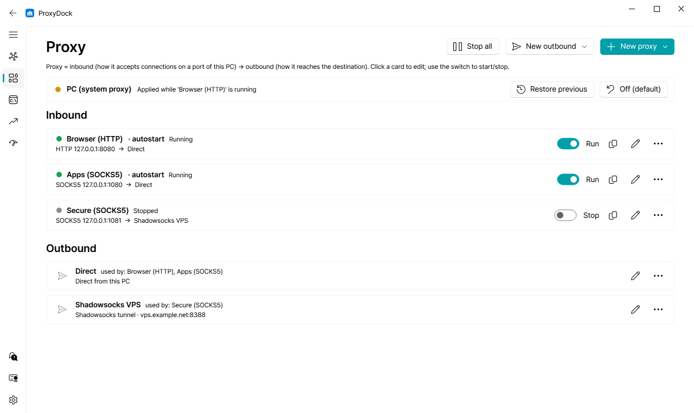

# ProxyDock

[English](../README.md) · **한국어** · [日本語](README.ja.md) · [简体中文](README.zh-CN.md) · [繁體中文](README.zh-TW.md) · [Deutsch](README.de.md) · [Français](README.fr.md) · [Español](README.es.md)

여러 개의 프록시를 만들어 각각 켜고 끄는 데스크톱 프록시 "도크"입니다. 개인적으로 쓰려고 만들었습니다.

프록시 하나는 **받는 쪽**(이 PC 의 포트로 연결을 받는 방식)과 **내보내는 쪽**(목적지까지 보내는 방식)의 조합입니다.
예를 들어 "로컬 SOCKS5 로 받아서 → 원격 Shadowsocks 서버로 암호화 터널" 같은 구성을 카드 하나로 만들 수 있습니다.

<p align="center">
  
</p>
<p align="center">
  
  
</p>

## 기능

| 구분 | 지원 |
|---|---|
| 받는 쪽 | SOCKS5 · SOCKS4/4a · HTTP · HTTPS(TLS) · Shadowsocks 서버 · Hysteria2 서버 |
| 내보내는 쪽 | Direct · 상위 HTTP / HTTPS / SOCKS4 / SOCKS5 프록시 · Shadowsocks 터널 · Hysteria2(QUIC) 터널 |
| UDP | 받을 때 SOCKS5 · Shadowsocks · Hysteria2, 보낼 때 Direct · Shadowsocks · Hysteria2 |

- **캔버스**: 블루프린트식 편집기 - 받는 쪽 블록에서 내보내는 쪽 블록으로 선을 끌어 잇습니다. 여러 받는 쪽이 내보내는 쪽 하나를 같이 쓸 수 있고, 받는 쪽을 다른 받는 쪽에 이으면 그쪽을 거쳐 중계하며, Direct 는 보낼 IP 를 고를 수 있습니다
- **PC 블록**: HTTP 받는 쪽을 이으면 실행 중일 때 Windows 시스템 프록시로 씁니다. 이전 설정은 저장해 두었다가 중지하거나 앱을 끄면 되돌립니다 (이전으로 되돌리기 / 끄기 버튼)
- **체인**: 내보내는 쪽 블록의 '경유' 출력을 이으면 그 서버로의 연결이 다른 내보내는 쪽을 거쳐 나갑니다 (예: 회사 HTTP 프록시 너머의 Shadowsocks, Hysteria2 터널 안의 HTTPS 상위 프록시). 몇 단계든 이을 수 있습니다
- **Shadowsocks**: AEAD 2018(aes-128/256-gcm, chacha20-ietf-poly1305) 과 2022(SIP022, blake3) 방식, TCP+UDP, `ss://` 링크 복사
- **Hysteria2**: 공식 구현과 양방향 호환 확인 (TCP·UDP), 인증서 지문 고정, `hysteria2://` 링크 복사
- **설정**: 전역 기본값 + 프록시별 로컬 설정(로컬 우선) - 허용 도메인, 내부망 차단, 유휴 타임아웃, 로그
- **편집 화면 연결 확인**: 저장 전에 내보내는 쪽(상위 프록시·터널·비밀번호)과 받는 쪽 포트를 시험
- **연결 테스트**: 실행 중인 프록시를 거쳐 여러 나라 사이트 21곳에 HTTPS 로 접속해 응답 시간 측정
- **로그 / 통계**: 프록시별로 골라 보기, 실시간 속도 그래프, 파일 로그(선택)
- **보안**: 비밀번호는 Windows DPAPI(그 외 OS 는 0600 권한 파일)로 보관, IP 별 연결 상한,
  인증 실패가 반복되면 일시 차단, 프록시 체인 순환 방지, Windows 방화벽 외부 차단 버튼
- **언어**: English(기본), 한국어, 日本語, 简体中文, 繁體中文, Deutsch, Français, Español (설정 → 화면 → 언어)
- 트레이 상주, 시작 프로그램 등록, 라이트/다크 테마, 내장 글꼴(Pretendard / JetBrains Mono)

## 실행

[Releases](https://github.com/NenkaLab/proxy-dock/releases) 에 빌드된 파일이 있으면 그것을 쓰거나, 소스에서 바로 실행합니다.

```bash
python -m venv .venv
# Windows: .venv\Scripts\activate   /   macOS·Linux: source .venv/bin/activate
pip install -r requirements.txt
python proxydock.py            # --hidden : 창 없이 트레이로 시작
```

Python 3.14 기준으로 개발·테스트했습니다.

처음 실행하면 프록시가 없습니다. **새 프록시** 에서 템플릿(로컬 SOCKS5, 로컬 HTTP, Shadowsocks 서버,
로컬 → Shadowsocks 터널 등)을 골라 만들고, 카드의 스위치로 실행합니다. 자세한 사용법은 앱의 **사용 방법** 화면에 있습니다.
화면 언어는 기본이 영어이며 설정 → 화면 → 언어에서 바꿀 수 있습니다 (재시작 후 적용).

설정 위치

| OS | 경로 |
|---|---|
| Windows | `%APPDATA%\ProxyDock` |
| macOS | `~/Library/Application Support/ProxyDock` |
| Linux | `$XDG_CONFIG_HOME/ProxyDock` (기본 `~/.config/ProxyDock`) |

## 빌드

빌드 관련 파일은 모두 [`tools/`](../tools/) 에 있습니다. PyInstaller 로 단일 실행 파일(macOS 는 `.app`)을 만듭니다.
스크립트가 OS 별 가상환경을 만들고 `requirements.txt` 와 다른 패키지만 설치한 뒤 `tools/ProxyDock.spec` 으로 빌드합니다.
어느 폴더에서 실행해도 됩니다.

| 명령 | 결과 |
|---|---|
| `tools\build_win.bat` | `dist/win/ProxyDock.exe` (Windows 에서) |
| `tools\build_linux.bat` / `tools/build_linux.sh` | `dist/linux/ProxyDock` (Linux 에서는 직접, Windows·macOS 에서는 Docker 로) |
| `tools/build_mac.sh` | `dist/mac/ProxyDock.app` (macOS 에서만) |
| `tools\build.bat` / `tools/build.sh` | 이 컴퓨터에서 가능한 것을 모두 빌드하고 결과 요약 |

macOS 빌드는 아직 실제 Mac 에서 확인하지 않았습니다.

## 릴리스와 CI

- 푸시와 PR 마다 Windows·Linux·macOS 에서 테스트가 돕니다 ([CI](../.github/workflows/ci.yml),
  로컬에서는 `python tests/run_tests.py` - 인터넷 불필요).
- `tools\release.bat 2.1.0` (또는 `python tools/release.py 2.1.0`) 은 작업 트리를 확인하고 테스트를 돌린 뒤
  `__version__` 을 올려 커밋하고 `v2.1.0` 태그를 만들어 푸시합니다. 태그가 [릴리스 워크플로](../.github/workflows/release.yml)를
  시작해 Windows / Linux / macOS 를 빌드하고 압축 파일과 `SHA256SUMS.txt` 를 GitHub Release 로 올립니다.
  `--dry-run` 을 붙이면 미리 확인만 합니다.
- `python tools/build.py package win|linux|mac` 로 같은 압축 파일을 로컬 `dist/release/` 에 만들 수 있습니다.

## 알려진 제한

- Hysteria2 (QUIC/UDP) 는 다른 내보내는 쪽을 *거쳐* 나갈 수 없고 (다른 블록이 Hysteria2 를 거치는 것은 가능), 체인으로 이은 내보내는 쪽으로는 UDP 를 보내지 않습니다.
- Hysteria2 는 Python QUIC 구현(aioquic) 위에서 동작해 약 100 Mbps 수준입니다. 대역폭 지정(Brutal),
  Salamander 난독화, 포트 호핑은 지원하지 않습니다.
- 공식 Hysteria2 서버는 SNI 와 인증서 도메인이 다르면 연결을 거부합니다 - 내보내는 쪽 SNI 에 서버 인증서 도메인을 넣으세요.
- HTTP 받는 쪽의 일반(비 CONNECT) 요청은 연결당 요청 하나만 처리합니다.
- SOCKS4 는 프로토콜에 비밀번호 인증이 없으므로 이 PC 에서만 쓰세요.
- 일본어·중국어는 시스템 UI 글꼴을 씁니다 (내장 Pretendard 는 한글·라틴 문자용).

## 구조

```
proxydock.py            진입점
proxydock/
  common.py             공통 상수·로그·주소 처리·차단 목록
  config.py             설정 형식(v2), 검증, 전역/로컬 병합, 비밀번호 보관, 이전 버전 설정 이전
  graph.py              블록 그래프 (받는 쪽 / 내보내는 쪽 / PC 블록) -> 실행용 프록시
  runtime.py            ProxyInstance / ProxyManager (asyncio 스레드 하나에서 여러 프록시 실행)
  relay.py              TCP/UDP 중계 코어
  inbound.py            받는 쪽 프로토콜
  outbound.py           내보내는 쪽 프로토콜
  ss.py                 Shadowsocks 2018/2022 암호화
  hysteria2.py          Hysteria2 서버·클라이언트 (aioquic)
  tls.py                자체 서명 인증서, TLS 컨텍스트
  probe.py              연결 테스트 / 연결 확인
  platform_utils.py     시작 프로그램, 방화벽, 포트 확인
  i18n.py, locales/     번역 (코드의 영어 원문 -> <언어>.json)
  ui/                   PySide6 + Fluent Widgets 화면
    canvas.py           캔버스 화면 (NodeGraphQt)
tools/                  빌드 스크립트, PyInstaller spec, Linux 빌드용 Dockerfile
licenses/               포함된 제3자 구성요소 라이선스
docs/                   번역된 README, 화면 캡처
```

### 번역

화면 문구는 코드에 영어로 쓰여 있고(`_t("...")`) `proxydock/locales/<언어>.json` 으로 번역됩니다.
번역이 없는 문구는 영어로 표시됩니다.

## 라이선스

[GPL-3.0](../LICENSE). UI 라이브러리 [PySide6-Fluent-Widgets](https://github.com/zhiyiYo/PyQt-Fluent-Widgets) 가
GPL v3 이므로 이 프로그램도 GPL v3 로 배포합니다. 빌드한 실행 파일을 배포할 때도 GPL v3 조건(소스 제공 등)을 따라야 합니다.

포함된 글꼴·라이브러리의 라이선스는 [`licenses/`](../licenses/) 폴더에 있습니다.

| 구성요소 | 라이선스 |
|---|---|
| Pretendard, JetBrains Mono (내장 글꼴) | SIL OFL 1.1 |
| PySide6-Fluent-Widgets | GPL v3 |
| Qt 6 / PySide6 / Shiboken6, PySideSix-Frameless-Window | LGPL v3 |
| aioquic, pylsqpack, darkdetect | BSD 3-Clause |
| cryptography | Apache 2.0 / BSD 3-Clause |
| pyOpenSSL | Apache 2.0 |
| service-identity, attrs, NodeGraphQt, Qt.py | MIT |
| certifi | MPL 2.0 |
| Python 런타임 | PSF License |
| PyInstaller 부트로더 | GPL v2+ (부트로더 예외) |

Copyright (C) 2026 NenkaLab
