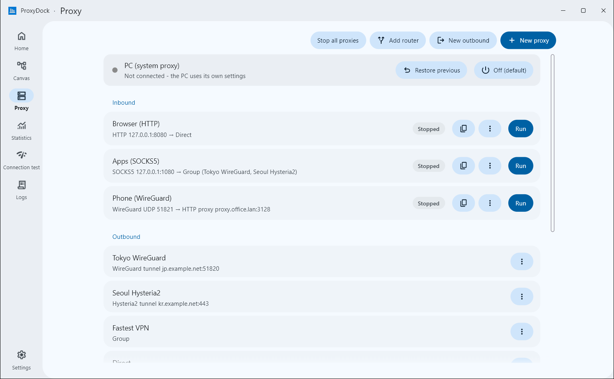

# ProxyDock

[English](../README.md) · [한국어](README.ko.md) · [日本語](README.ja.md) · **简体中文** · [繁體中文](README.zh-TW.md) · [Deutsch](README.de.md) · [Français](README.fr.md) · [Español](README.es.md)

同时运行多个代理和隧道的桌面应用。在画布上把**入站**块 (流量进入的方式，例如本地 SOCKS5 端口) 连到
**出站**块 (流量离开的方式，例如 Shadowsocks 服务器)，每张卡片可单独开关。

这是为个人使用而做的工具，按原样分享。

  <picture>
    <source media="(prefers-color-scheme: dark)" srcset="images/canvas-dark.png">
    
  </picture>

  <picture>
    <source media="(prefers-color-scheme: dark)" srcset="images/proxies-dark.png">
    
  </picture>
  <picture>
    <source media="(prefers-color-scheme: dark)" srcset="images/router-dark.png">
    
  </picture>

## 功能

- **在画布上连接块**：把入站（SOCKS5、HTTP、Shadowsocks / Hysteria2 / WireGuard 服务器、TUN 等）
  连到出站（直连、上游代理、Shadowsocks、Hysteria2、WireGuard、VLESS、VMess、Trojan、TUIC、订阅）
- **路由**：按域名、IP、程序或国家分流；IF 开关可当作断网保护（kill switch）；分组选用最快的服务器或自动切换
- **链式**：让一个出站经过另一个出站，或经过 Tailscale、VPN 应用、Wi-Fi
- **系统代理**：在卡片运行期间把它用作 Windows 系统代理
- **常用工具**：分享链接、连接测试、日志和实时统计、8 种语言、托盘
- **线路直连**：让选定的块直接从网卡发出，绕过接管整台电脑网络的 VPN、TUN 或其他应用，无需它们的分流功能
  （Windows：小型 Hyper-V 虚拟机；Linux：网络命名空间；macOS：小型虚拟机，尚未测试）
- **主页**：整个应用的开关（关闭即拒绝所有连接的断网开关；每张卡片的开关状态保持不变）、卡片状态、实时流量、
  线路直连虚拟机

代理由 [sing-box](https://github.com/SagerNet/sing-box) 运行，已随发布版附带。

## 运行

从 [Releases](https://github.com/NenkaLab/proxy-dock/releases) 下载。

- **Windows 10 / 11**：`ProxyDock-<版本>-windows-x64-setup.exe` 为当前用户安装 (不需要管理员权限)；`.zip` 是同一个应用的
  文件夹版本。
- **macOS** (Apple Silicon)：打开 `.dmg`，把 ProxyDock 拖到"应用程序"文件夹。没有 Apple 签名，第一次请右键 → 打开。
- **Linux** (x64)：`.AppImage` 可直接运行 (先 `chmod +x`)；`.tar.gz` 是同一个应用的文件夹版本。

设置保存在 `%APPDATA%\ProxyDock` (Windows)、`~/Library/Application Support/ProxyDock` (macOS) 或 `~/.config/ProxyDock`
(Linux)，版本 3 直接读取 2.x 的设置。其余内容见应用内的**使用方法**页面。ProxyDock 3 是用 Rust 重写的版本，2.x
(Python 版) 在 [`old`](https://github.com/NenkaLab/proxy-dock/tree/old) 分支。

## 构建

从源码运行、测试、构建、安装包和发布：[Build.md](Build.md)（英文）。发布前的检查方法：[TESTING.md](../TESTING.md)（韩文）。

## 限制

- macOS 和 Linux 已自动构建和测试，但还没有在真机上试过。
- macOS / Linux：没有阻止其他电脑的防火墙规则 (请用系统防火墙)，启动时没有"以管理员身份运行" (TUN 卡片启动时会询问
  密码)，不读取显示器色彩配置文件 (按 sRGB 处理)，设置中的密码不加密 (与 2.x 相同)，鼠标的后退/前进键不会返回。
- Linux：系统代理 (PC 块) 只在 GNOME 和 KDE 上设置；通知需要 `notify-send`。
- TUN 还没有在真实环境中试过。
- SOCKS4 没有密码，只在本机使用。
- 线路直连：在 Windows 上需要 Hyper-V（专业版、企业版或教育版）和管理员权限；每台虚拟机在路由器上显示为新设备
  （有自己的 MAC 和 IP 地址），如果服务商每条线路只分配一个地址，它可能获取不到地址。这些流量会暴露你的真实 IP
  地址，不受任何 VPN 保护：使用责任由你承担（应用在创建虚拟机前会征求同意）。
- Linux 上的线路直连：只在容器中测试过（使用 macvlan 的网络命名空间；Wi-Fi 使用 ipvlan，可能无法 DHCP，请使用
  固定地址）。需要 `ip`（iproute2）以及通过 pkexec 获得的 root 权限。
- macOS（Apple 芯片）上的线路直连：只写好了代码并做了类型检查，**尚未在任何 Mac 上测试过**
  （Virtualization.framework 加桥接的 vmnet 接口，助手需要以 root 运行）。

## 贡献

如果你修复或改进了什么——bug、尚未测试的平台（macOS、Linux）、翻译——欢迎提交 pull request。自己写或用 AI
都可以，但提交前请务必验证：构建、运行测试（在 `native/` 中执行 `cargo test --workspace`），并在应用里实际试用
改动（必要时在真机上）。请在 pull request 里说明你检查了什么、怎么检查的。

## 许可证

[GPL-3.0](../LICENSE)。内置组件 (sing-box GPL-3.0、Hysteria MIT、Slint GPL-3.0、Rust crate、字体 OFL-1.1 等) 及其许可证
见 [`licenses/`](../licenses/)。

Copyright (C) 2026 NenkaLab
